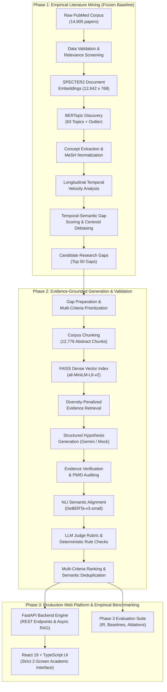
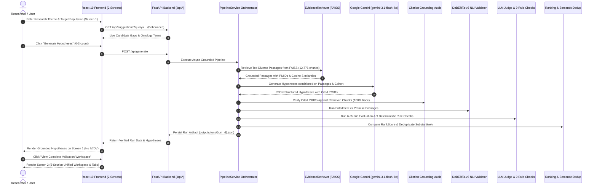

# System Architecture & Technical Specifications

**Project Title:** Temporal-Semantic Gap-Guided Evidence-Grounded Hypothesis Generation in mHealth Research  
**Target Platform:** Python 3.11+ / FastAPI / React 19 / TypeScript / Vite / FAISS / Windows 11  
**Project Root:** `E:\Major_Project_Implementation`  

---

## 1. High-Level Architectural Overview

The system is organized into three decoupled phases following a strict **Gap-First, Literature-Grounded Architecture**:



---

## 2. Component Design & Module Contracts

### 2.1 Directory Structure
```text
E:\Major_Project_Implementation\
│
├── config.yaml                   # Central parameter registry (Phases 1, 2, 3)
├── requirements.txt             # Pinned package dependencies
├── .env                          # Local credentials (GEMINI_API_KEY)
├── run_phase1.py                 # Phase 1 master pipeline runner
├── run_phase2.py                 # Phase 2 master pipeline runner
├── run_tests.py                  # Master test suite runner (45 tests)
├── backend/                      # Production FastAPI application & RAG orchestration
│   ├── app.py                    # FastAPI entrypoint with CORS & routes
│   ├── schemas.py                # Pydantic v2 data models
│   ├── routes/api.py             # REST endpoints (health, suggestions, generate, runs)
│   └── services/                 # Theme matcher, pipeline service, evaluation service
├── frontend/                     # React 19 + TypeScript + Vite + Tailwind UI
│   ├── src/pages/                # Screen 1 (GeneratePage) & Screen 2 (WorkspacePage)
│   ├── src/components/           # Modular components (Suggestions, Cards, Validation Tabs)
│   └── src/services/api.ts       # Typed API client
├── legacy_streamlit_app.py       # Preserved Streamlit prototype
│
├── src/                          # Modular Python source packages
│   ├── config_loader.py          # Path resolver, YAML loader, random seeds
│   ├── data_validation.py        # Phase 1: schema checks and text validation
│   ├── relevance_screening.py    # Phase 1: rule-based mHealth scoring
│   ├── text_preprocessing.py     # Phase 1: scientific text cleaning
│   ├── embeddings.py             # Phase 1: SPECTER2 document embedding
│   ├── topic_modeling.py         # Phase 1: BERTopic cluster discovery
│   ├── concept_extraction.py     # Phase 1: MeSH keyword extraction
│   ├── mesh_normalization.py     # Phase 1: MeSH concept normalization
│   ├── temporal_analysis.py      # Phase 1: longitudinal trend slopes
│   ├── concept_quality_filter.py # Phase 1: centroid debiasing and filtering
│   ├── gap_detection.py          # Phase 1: gap scoring and candidate export
│   ├── visualization.py          # Phase 1: publication figures generator
│   │
│   ├── phase2/                   # Phase 2 Generation & Validation Package
│   │   ├── __init__.py           # Package exports
│   │   ├── gap_preparation.py    # Gap loading, schema validation, prioritization
│   │   ├── chunking.py           # Passage chunking with metadata preservation
│   │   ├── retrieval.py          # FAISS IndexFlatIP retriever with diversity
│   │   ├── hypothesis_generation.py # Structured Gemini generator & mock engine
│   │   ├── evidence_verification.py # Deterministic citation & PMID validation
│   │   ├── nli_validation.py     # DeBERTa-v3 cross-encoder NLI validation
│   │   ├── llm_judge.py          # 6-dimension LLM quality rubric evaluator
│   │   ├── rule_checks.py        # Deterministic falsifiability and language rules
│   │   ├── ranking.py            # Multi-criteria composite ranking
│   │   └── deduplication.py      # Dense semantic clustering & difference check
│   │
│   └── phase3/                   # Phase 3 Evaluation & Benchmarking Package
│       ├── __init__.py           # Package exports
│       ├── retrieval_eval.py     # Precision@K, Recall@K, MRR, nDCG@K
│       ├── grounding_eval.py     # Citation validity and traceability metrics
│       ├── baseline_comparison.py# Comparative experiments vs baselines
│       ├── ablation_study.py     # Component marginal utility benchmarks
│       └── run_evaluation.py     # Master Phase 3 experiment runner
│
├── tests/                        # 9 Modular Unit & Integration Test Suites
│   ├── test_phase1_artifacts.py
│   ├── test_gap_preparation.py
│   ├── test_chunking.py
│   ├── test_retrieval.py
│   ├── test_hypothesis_generation.py
│   ├── test_validation.py
│   ├── test_ranking_deduplication.py
│   ├── test_end_to_end_pipeline.py
│   ├── test_api_endpoints.py
│   └── test_react_frontend.py
│
├── outputs/                      # Intermediate and final verified artifacts
├── models/bertopic_model/        # Reusable trained BERTopic artifacts
├── figures/                      # Publication-grade figures
└── logs/                         # Execution logs with timestamps
```

---

## 3. End-to-End Sequence Diagram



---

## 4. Security, Credentials & Offline Compliance

1. **Environment Variables**: API keys (`GEMINI_API_KEY`) are accessed via `os.environ` or a local `.env` file that is strictly ignored by version control (`.gitignore`).
2. **Zero Cost During Testing**: The entire test suite and evaluation pipeline executes using offline mock engines (`use_mock=True`), eliminating accidental API spend.
3. **No Uncontrolled Execution**: No external code execution or dynamic `eval` is used. All JSON responses are strictly validated through explicit schemas with regex fallback parsers.
